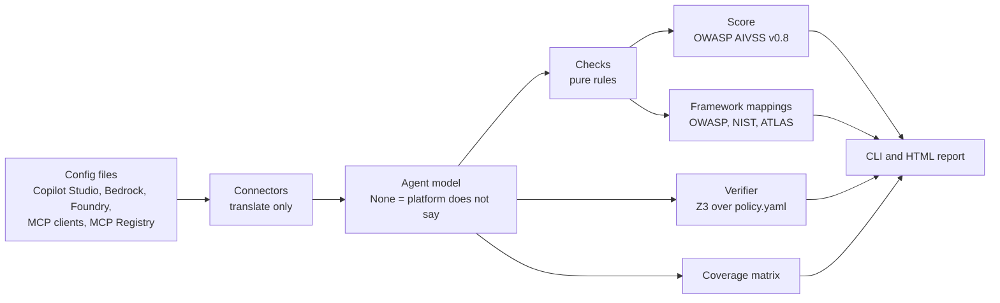

# Discover Lite

Discover Lite is a small static analyser for AI agent configurations. It reads how agents and MCP clients are set up (their instructions, tools, knowledge sources and access settings) from local files, flags risky setups, scores each risk with OWASP AIVSS, maps it to security frameworks, and proves properties of tool policies with a solver. Every check is a fixed, deterministic rule: there is no AI model inside the tool, and scanning never touches the network. It is a learning project modelled on the "Discover" capability at Outerlimit.

## Headline results on real data

Run over 2,009 public MCP client configs from GitHub and all 45,372 servers in the official MCP Registry (details in `docs/github-findings.md` and `docs/registry-findings.md`):

- **93% of servers started with `npx` or `uvx` in real configs have no exact version**, and 30% ask for `@latest` by name, so every client start may download and run new code. In the registry the same rule finds almost none (22 of 15,695 packages): publishers pin, users do not.
- **1.8% of configs (about 1 in 60) hold a real-looking credential**, matched by gitleaks' vendor key formats or by a generated-looking value under a secret name. Values are always redacted, and no key was ever tried.
- **Plain HTTP is rare** (7 of 594 remote servers), but 67% of remote servers send no Authorization header, which is often fine because many sign in with OAuth instead.

## Quick start

Needs Python 3.10 or later. All dependencies, including the Z3 solver, install as wheels from PyPI.

```bash
python -m venv .venv
.venv/bin/pip install -e ".[dev]"

.venv/bin/discover-lite scan fixtures/            # findings and an AIVSS score per agent
.venv/bin/discover-lite scan fixtures/ --json     # the same, with framework mappings
.venv/bin/discover-lite verify fixtures/          # prove tool-policy properties with Z3
.venv/bin/discover-lite coverage fixtures/        # which signals each platform gives
.venv/bin/discover-lite report fixtures/ -o report.html
.venv/bin/pytest
```

Every scanning command (`scan`, `report`, `verify`, `coverage`) takes either a folder, which is searched for `.json` files, or a single config file of any supported kind:

```bash
.venv/bin/discover-lite scan fixtures/bedrock_travel_agent.json                       # terminal output
.venv/bin/discover-lite scan fixtures/bedrock_travel_agent.json --json                # JSON output
.venv/bin/discover-lite scan ~/.cursor/mcp.json --report cursor.html                  # terminal output and an HTML report
.venv/bin/discover-lite report fixtures/copilot_refunds_bot.json -o refunds.html      # HTML report only
.venv/bin/discover-lite verify fixtures/copilot_refunds_bot.json                      # uses policies/ beside the file
```

Supported files: Copilot Studio agents, AWS Bedrock agents, Microsoft Foundry agents, MCP client configs (Claude Desktop, Claude Code, Cursor, VS Code, Windsurf, Cline, Gemini CLI) and MCP Registry pages. A single file in any other format (an OpenAI or Google ADK agent, for example, which has no connector yet) stops with an error and exit code 1, so it is never mistaken for a clean result.

Real public data (the only commands that use the network):

```bash
.venv/bin/discover-lite fetch-registry              # the whole official MCP Registry, saved to data/registry/
.venv/bin/discover-lite fetch-registry --limit 500  # only the first 500 entries
.venv/bin/discover-lite fetch-github --limit 600    # public client configs (needs `gh auth login`)
.venv/bin/discover-lite stats data/registry/
.venv/bin/discover-lite stats data/github-configs/
```

`--limit` sets how many items to download: for `fetch-registry`, entries (one per server version, default 0 = the whole registry, about 45,000 servers at 100 a page); for `fetch-github`, new config files (default 300, split evenly across the six clients). `--out` changes the folder.

Downloaded data stays in `data/`, which is not committed. `stats` prints counts only, never values, names or repositories, and `review-secrets data/github-configs/` lists each secret hit with its value redacted so a person can judge it by eye before any rate is quoted.

## Example output

```
$ discover-lite scan fixtures/copilot_refunds_bot.json
Refunds Bot  (copilot_studio, fixtures/copilot_refunds_bot.json)  AIVSS: 7.9-9.3 (High-Critical)
  agentic factors: 5 of 10 shown in the config (sum 3), 5 not shown
  [HIGH  ] AIVSS  7.9- 9.3 no_human_in_loop: Tool 'IssueRefund' (write) runs without approval

1 agent, 1 findings (1 high, 0 medium, 0 low)
0 of 2 tools could not be classified as read or write
```

```
$ discover-lite verify fixtures/copilot_refunds_bot.json
Refunds Bot  (fixtures/policies/copilot_refunds_bot.yaml)
  VIOLATED Every allowed write needs approval: counterexample: IssueRefund(amount=4, approved=False) is allowed
  VIOLATED No contradictory rules: counterexample: IssueRefund(amount=5000) matches both an allow and a deny rule
  PROVED   Every tool is covered: every tool has a rule
```

Across all fixtures, `scan fixtures/` reports 14 agents and 20 findings (9 high, 8 medium, 3 low).

## How it fits together



- **Connectors** (`src/discover_lite/connectors/`) turn each file into an `Agent`. They never judge.
- **Checks** (`checks/__init__.py`) are pure functions `Agent -> list[Finding]`. A field that is `None` means "the platform does not say" and never fires a check.
- **Scoring** (`aivss.py`) applies OWASP AIVSS v0.8 to each security finding: the check's CVSS v4.0 base score, raised by ten agentic factors read from the config. See "Risk scores" below.
- **Verifier** (`verifier.py`) uses Z3 to search every possible tool call against a policy file and returns a counterexample when a property fails. An agent with no policy file is listed as not verified, and `verify` exits with code 1 when nothing could be checked, so a missing policy never reads as a pass.

## Checks

| Check | Severity | What it flags | OWASP LLM 2026 | MITRE ATLAS | NIST AI RMF |
|---|---|---|---|---|---|
| `secret_in_config` | high / low | A secret in a server's env, headers or args: a vendor key format from gitleaks' rules or a generated-looking value (high), or typed text under a secret name, usually a placeholder (low) | LLM02 | AML.T0083, AML.T0055 | Measure, Manage |
| `no_human_in_loop` | high | A write or execute tool explicitly set to run without approval | LLM03 | AML.T0053, AML.T0086, AML.T0101 | Govern, Manage |
| `prompt_injection_exposure` | high | Reads untrusted content (web search) and has an action tool | LLM01 | AML.T0051.001, AML.T0053 | Map, Manage |
| `open_access` | high / medium | No authentication, or shared with the whole organisation | LLM02 | AML.T0132 | Govern, Manage |
| `insecure_remote_server` | high / low | Plain HTTP to a remote host, or no Authorization header | LLM02 | AML.T0132 | Measure, Manage |
| `unpinned_package` | medium | `npx` / `uvx` package, or registry package, with no exact version | LLM04 | AML.T0010.005, AML.T0109 | Map, Manage |
| `broad_filesystem_access` | medium | A filesystem server given a whole disk or home folder | LLM03 | AML.T0037, AML.T0112.000 | Map, Manage |
| `missing_scope` | medium | Instructions under 10 words | LLM03 | AML.T0051.000, AML.T0054 | Govern, Map |
| `no_guardrail` | medium | No guardrail attached (Bedrock) | LLM01, LLM02 | AML.T0051, AML.T0054, AML.T0057 | Manage |
| `topic_overlap` | medium | Two topics whose trigger phrases overlap (TF-IDF), naming the shared words. No current connector supplies topics, so it runs only on agents that have them | quality finding | none (quality) | Measure |
| `unclassified_tool` | low | A tool we cannot classify, running without approval | quality finding | none (quality) | Map |

Vendor key formats come from the default rules of [gitleaks](https://github.com/gitleaks/gitleaks) (MIT licence), copied unchanged into `src/discover_lite/rules/`.

The full mappings, with a one-sentence reason for each, are in `src/discover_lite/mappings.yaml`. ATLAS techniques were checked against ATLAS release 2026.09; each is a technique the finding makes easier for an attacker.

## Risk scores

Scores follow [OWASP AIVSS v0.8](https://aivss.owasp.org/) (AI Vulnerability Scoring System), a published method for agentic AI. Nothing in the formula is ours:

```
AARS  = (10 - CVSS_Base) * (Factor_Sum / 10) * ThM
AIVSS = RoundHalfUp((CVSS_Base + AARS) * Mitigation_Factor, 1)
```

- **CVSS_Base:** each check's CVSS v4.0 base vector is in `mappings.yaml`, with a one-line reason for its metrics, and the `cvss` library computes the score. Checks that report two severities have a vector for each. Quality checks have none: they are not vulnerabilities, so they are not scored.
- **Factor_Sum:** ten agentic factors (Autonomy, Tools, Language, Context, Non-Determinism, Opacity, Persistence, Identity, Multi-Agent, Self-Mod), each 0.0, 0.5 or 1.0 by the spec's rubric, read from the config where it shows them. For example, a write tool with approval off is Autonomy 1.0, and a Bedrock guardrail makes Non-Determinism 0.5.
- **ThM = 0.97 and Mitigation_Factor = 1.0:** the spec's defaults. A config cannot show exploit maturity or validated mitigations.
- **A range, not a guess:** configs never show memory, logging, identity changes or other agents, and MCP configs do not list their servers' tools. Each score is therefore a range: the low end counts only what the config shows, the high end gives every unshown factor the worst value. Both ends are valid AIVSS scores, and the range closes as more of the agent becomes visible.
- **An agent's score** is its highest finding's score. Bands are the spec's (and CVSS's): Low under 4.0, Medium to 6.9, High to 8.9, Critical from 9.0.

The formula is tested against the eight worked examples in section 3.6 of the specification.

## Tool policies and the verifier

A policy is a short YAML file of rules saying when each tool may run. It lives in a `policies/` folder beside the configs, named after the config file (`copilot_refunds_bot.json` uses `policies/copilot_refunds_bot.yaml`):

```yaml
rules:
  - tool: LookupOrder
    effect: allow
  - tool: IssueRefund
    effect: allow
    when: {amount_max: 100}     # optional amount_min / amount_max, inclusive
    require_approval: false
  - tool: IssueRefund
    effect: allow
    when: {amount_min: 101}
    require_approval: true
  - tool: IssueRefund
    effect: deny                # deny always wins over allow
    when: {amount_min: 5000}
```

The verifier models one tool call as two unknowns, an integer `amount` (0 or more) and a yes/no `approved`, and asks Z3 whether any call breaks each property. Z3 reasons over every integer at once, so "proved" means true for all amounts, not for the ones a test happened to try, and "violated" comes with a concrete call that breaks the rule:

1. **Every allowed write needs approval.** No call to a write or execute tool is allowed without approval. Above, any refund from 0 to 100 skips approval; Z3 reports one such amount.
2. **No contradictory rules.** No call matches both an allow and a deny rule for the same tool. Above, every refund from 5,000 upwards matches both. Deny wins here, but the meaning then depends on how a platform resolves conflicts; `amount_max: 4999` on the second allow rule removes the overlap.
3. **Every tool is covered.** Every tool the connector found has at least one rule. This is a set difference and needs no solver.

The policy format is our own: no platform exports policies in this shape. It shows what a solver adds once a platform's real permission rules are translated into constraints.

## HTML report

`discover-lite report <target> -o report.html` writes one self-contained page with:

- an estate summary: counts by severity and the most common issues across all agents;
- agents ranked by AIVSS score, each with its agentic factors and scored findings (CVSS vector included);
- every finding with its OWASP, ATLAS and NIST mappings and the reason for each;
- the verifier's results for each agent that has a policy file;
- the coverage matrix: which signals each platform's files actually contain;
- the real-data statistics, when `data/github-configs/` or `data/registry/` exist;
- a "Where each part comes from" table separating published methods and rule sets from our own judgement calls, such as thresholds.

## Project layout

```
src/discover_lite/
  models.py            Agent, Tool, McpServer and Finding (pydantic)
  connectors/          one read-only parser per format: Copilot Studio, Bedrock,
                       Foundry, MCP client configs, MCP Registry pages
  checks/__init__.py   the posture checks, registered in ALL_CHECKS
  secret_rules.py      gitleaks' vendor key rules and an entropy measure
  rules/               gitleaks' default rules, unchanged, with their licence
  mappings.yaml        OWASP, ATLAS, NIST and CVSS v4.0 for each check
  aivss.py             OWASP AIVSS v0.8 scoring
  verifier.py          Z3 policy verification
  coverage.py          which Agent fields each platform fills in
  report.py            scanning and the HTML report (templates/report.html)
  fetch_github.py      download public client configs (gh CLI)
  fetch_registry.py    download the MCP Registry
  stats.py             aggregate statistics over downloaded data
  cli.py               the Typer command line
fixtures/              synthetic configs and policies used in the examples and tests
tests/                 pytest, 281 tests
docs/                  findings on real data and the coverage write-up
```

## Adding a check or a connector

- **A check** is a function `Agent -> list[Finding]` in `checks/__init__.py`, added to `ALL_CHECKS`, with an entry in `mappings.yaml` (frameworks, plus CVSS vectors if it is a security check) and at least one test that fires and one that does not. It must not fire on `None`.
- **A connector** turns one file format into an `Agent` and is registered in `connectors/__init__.py`. It translates only: fields the platform does not expose stay `None` rather than being guessed, and the coverage matrix then shows them as missing.

## What is real and what is modelled

- **Real data:** 45,372 servers from the official MCP Registry and public MCP client configs from GitHub. Results are in `docs/registry-findings.md` and `docs/github-findings.md`. Only aggregate counts are reported; no repository is named and every secret is redacted.
- **Real field names, synthetic values:** the Copilot Studio fixtures use only fields in Microsoft's [agent inventory schema](https://learn.microsoft.com/microsoft-copilot-studio/admin-agent-inventory) (`authentication`, `sharedWithViewers.entireTenant`, `IsWebSearchEnabledForKnowledge`, `powerPlatformConnectors[]` with `connectorId` and `operations[]`). The inventory has no instructions, topics or per-operation HTTP method, so the connector does not read any. Custom connectors in the fixtures have no `connectorId`, because their IDs are environment-specific and undocumented.
- **Real response shapes, synthetic values:** the Bedrock fixtures are saved `bedrock-agent` API responses, one per call: a `GetAgent` response (`*.json`) and a `GetAgentActionGroup` response for each action group (`*.actiongroup_*.json`), joined on `agentId` and `agentVersion`. Scan the agent file or the folder; an action group file on its own is not an agent.
- **Real response shape, synthetic values:** the Microsoft Foundry fixtures. Each file is one unchanged response from the Foundry Agent Service REST API (`GET /agents/{name}` or `GET /agents/{name}/versions/{version}`, `api-version=v1`), and every field the connector reads is in the [Foundry REST reference](https://learn.microsoft.com/rest/api/microsoft-foundry/aiproject). Nothing in the format is ours.
- **Real formats, synthetic values:** the MCP client fixtures. `fixtures/vscode/mcp.json` follows VS Code's format (`servers`, `inputs`, `${input:...}`) and `fixtures/web-app/.mcp.json` follows Claude Code's, including its remote `type: http` servers. The Claude Desktop fixture holds only local servers, as Claude Desktop adds remote ones through its Connectors settings.
- **Our own format:** the tool policy files in `fixtures/policies/`.

`docs/coverage.md` sets out what each platform exposes, what is missing, and the one signal I would most want from each.

## Limits

- It reads configuration, not behaviour. It never runs an agent or starts a server.
- Tool capability comes from the HTTP method where available and otherwise from words in the tool's name. Unclear names are marked unknown, never assumed to be read-only.
- Topic overlap compares words, not meaning: "locked" and "unlock" count as different words. The threshold (0.15) was tuned on a handful of examples.
- The verifier proves properties of the **policy as written**. It does not prove that the agent, the model or the platform follows the policy.
- The scoring method is published, but two inputs are still judgements: each check's CVSS v4.0 metric values (with reasons in `mappings.yaml`) and the factor rules in `aivss.py`. AIVSS itself is a v0.8 draft; its mitigation floor is described by the spec as provisional.
- AIVSS raises low CVSS scores a lot in a highly agentic context (the spec's own example takes 2.1 to 7.1), so most agents with any finding score High or Critical at the top of the range.
- The checks detect concrete settings; the frameworks describe categories of risk, not configuration rules. Mapping a check to a framework entry is therefore a judgement, recorded with its reason in `mappings.yaml`. The NIST AI RMF tags are the coarsest: the framework has only four functions.
- `missing_scope`'s 10-word threshold is our own choice, not taken from any standard.
- Copilot Studio's inventory holds no instructions or topics, so `missing_scope` and `topic_overlap` cannot run on Copilot Studio agents until a second source is read.

## Licence

MIT, see `LICENSE`. The gitleaks rules in `src/discover_lite/rules/` keep their own MIT licence (`LICENSE-gitleaks`).
