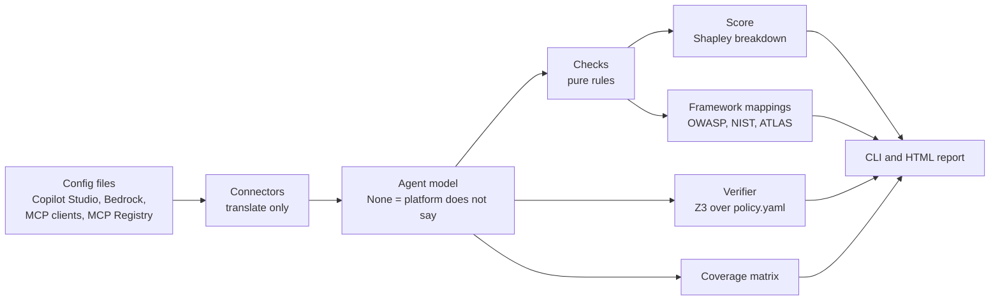

# Discover Lite

Discover Lite is a small static analyser for AI agent configurations. It reads how agents and MCP clients are set up (their instructions, tools, knowledge sources and access settings) from local files, flags risky setups, explains each risk with a score breakdown and framework mappings, and proves properties of tool policies with a solver. Every check is a fixed, deterministic rule: there is no AI model inside the tool, and scanning never touches the network. It is a learning project modelled on the "Discover" capability at Outerlimit.

## Quick start

```bash
python -m venv .venv
.venv/bin/pip install -e ".[dev]"

.venv/bin/discover-lite scan fixtures/            # findings and a risk score per agent
.venv/bin/discover-lite scan fixtures/ --json     # the same, with framework mappings
.venv/bin/discover-lite verify fixtures/          # prove tool-policy properties with Z3
.venv/bin/discover-lite coverage fixtures/        # which signals each platform gives
.venv/bin/discover-lite report fixtures/ -o report.html
.venv/bin/pytest
```

Every scanning command (`scan`, `report`, `verify`, `coverage`) takes either a folder, which is searched for `.json` files, or a single config file of any supported kind:

```bash
.venv/bin/discover-lite scan fixtures/bedrock_travel_agent.json                       # terminal output
.venv/bin/discover-lite scan fixtures/bedrock_travel_agent.json --json                # JSON output
.venv/bin/discover-lite scan ~/.cursor/mcp.json --report cursor.html                  # terminal output and an HTML report
.venv/bin/discover-lite report fixtures/copilot_refunds_bot.json -o refunds.html      # HTML report only
.venv/bin/discover-lite verify fixtures/copilot_refunds_bot.json                      # uses policies/ beside the file
```

Supported files: Copilot Studio agents, AWS Bedrock agents, MCP client configs (Claude Desktop, Claude Code, Cursor, VS Code, Windsurf, Cline, Gemini CLI) and MCP Registry pages. A single file in any other format (an Azure AI Foundry agent, for example, which has no connector yet) stops with an error and exit code 1, so it is never mistaken for a clean result.

Real public data (the only commands that use the network):

```bash
.venv/bin/discover-lite fetch-registry              # the whole official MCP Registry, saved to data/registry/
.venv/bin/discover-lite fetch-registry --limit 500  # only the first 500 entries
.venv/bin/discover-lite fetch-github --limit 600    # public client configs (needs `gh auth login`)
.venv/bin/discover-lite stats data/registry/
.venv/bin/discover-lite stats data/github-configs/
```

`--limit` sets how many items to download: for `fetch-registry`, entries (one per server version, default 0 = the whole registry, about 45,000 servers at 100 a page); for `fetch-github`, new config files (default 300, split evenly across the six clients). `--out` changes the folder.

## How it fits together



- **Connectors** (`src/discover_lite/connectors/`) turn each file into an `Agent`. They never judge.
- **Checks** (`checks/__init__.py`) are pure functions `Agent -> list[Finding]`. A field that is `None` means "the platform does not say" and never fires a check.
- **Scoring** (`scoring.py`) adds weights per failed check, a bonus for one dangerous pair, a cap of 100, and splits the score between checks with exact Shapley values so every point is explained.
- **Verifier** (`verifier.py`) uses Z3 to search every possible tool call against a policy file and returns a counterexample when a property fails.

## Checks

| Check | Severity | What it flags | OWASP LLM 2026 | MITRE ATLAS | NIST AI RMF |
|---|---|---|---|---|---|
| `secret_in_config` | high / low | A secret in a server's env, headers or args: a vendor key format from gitleaks' rules or a generated-looking value (high), or typed text under a secret name, usually a placeholder (low) | LLM02 | AML.T0083, AML.T0055 | Measure, Manage |
| `no_human_in_loop` | high | A write or execute tool explicitly set to run without approval | LLM03 | AML.T0053, AML.T0086, AML.T0101 | Govern, Manage |
| `prompt_injection_exposure` | high | Reads untrusted content (web search) and has an action tool | LLM01 | AML.T0051.001, AML.T0053 | Map, Manage |
| `open_access` | high / medium | No authentication, or shared with the whole organisation | LLM02 | AML.T0132 | Govern, Manage |
| `insecure_remote_server` | high / low | Plain HTTP to a remote host, or no Authorization header | LLM02 | AML.T0132 | Measure, Manage |
| `unpinned_package` | medium | `npx` / `uvx` package, or registry package, with no exact version | LLM04 | AML.T0010.005, AML.T0109 | Map, Manage |
| `broad_filesystem_access` | medium | A filesystem server given a whole disk or home folder | LLM03 | AML.T0037, AML.T0112.000 | Map, Manage |
| `missing_scope` | medium | Instructions under 10 words | LLM03 | AML.T0051.000, AML.T0054 | Govern, Map |
| `no_guardrail` | medium | No guardrail attached (Bedrock) | LLM01, LLM02 | AML.T0051, AML.T0054, AML.T0057 | Manage |
| `topic_overlap` | medium | Two topics whose trigger phrases overlap (TF-IDF), naming the shared words | quality finding | none (quality) | Measure |
| `unclassified_tool` | low | A tool we cannot classify, running without approval | quality finding | none (quality) | Map |

Vendor key formats come from the default rules of [gitleaks](https://github.com/gitleaks/gitleaks) (MIT licence), copied unchanged into `src/discover_lite/rules/`.

The full mappings, with a one-sentence reason for each, are in `src/discover_lite/mappings.yaml`. ATLAS techniques were checked against ATLAS release 2026.09; each is a technique the finding makes easier for an attacker.

## What is real and what is modelled

- **Real data:** 45,372 servers from the official MCP Registry and public MCP client configs from GitHub. Results are in `docs/registry-findings.md` and `docs/github-findings.md`. Only aggregate counts are reported; no repository is named and every secret is redacted.
- **Real field names, synthetic values:** the Copilot Studio and Bedrock fixtures. Copilot Studio fields follow Microsoft's agent inventory schema; `instructions`, `topics` and each operation's `method` are our own additions. Bedrock fields follow the `bedrock-agent` API (`GetAgent`, `GetAgentActionGroup`); bundling the responses into one file is our choice.
- **Our own format:** the tool policy files in `fixtures/policies/`.

`docs/coverage.md` sets out what each platform exposes, what is missing, and the one signal I would most want from each.

## Limits

- It reads configuration, not behaviour. It never runs an agent or starts a server.
- Tool capability comes from the HTTP method where available and otherwise from words in the tool's name. Unclear names are marked unknown, never assumed to be read-only.
- Topic overlap compares words, not meaning: "locked" and "unlock" count as different words. The threshold (0.15) was tuned on a handful of examples.
- The verifier proves properties of the **policy as written**. It does not prove that the agent, the model or the platform follows the policy.
- The risk weights are judgement calls, not measured probabilities. The Shapley breakdown makes the arithmetic transparent; it does not make the weights correct.
